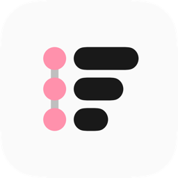
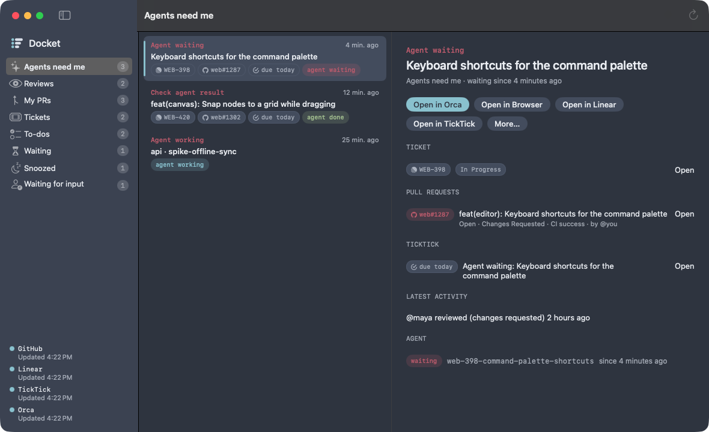
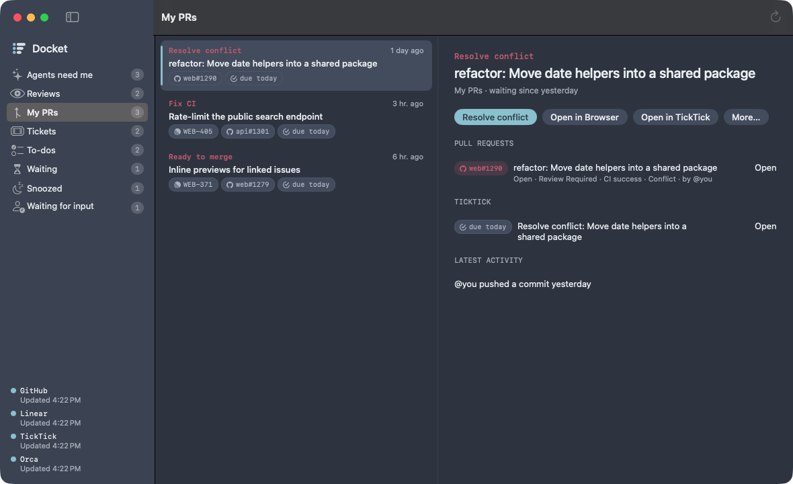
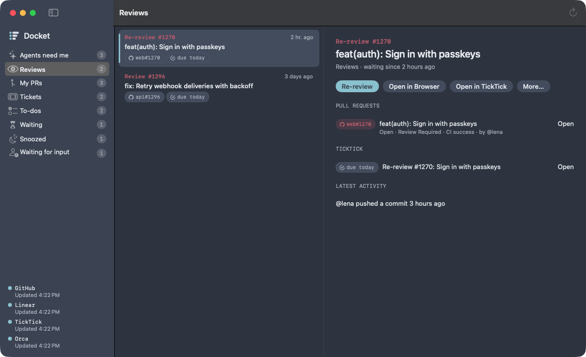
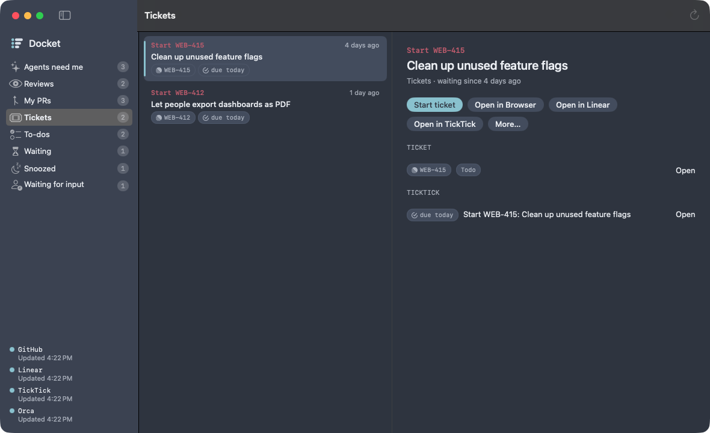
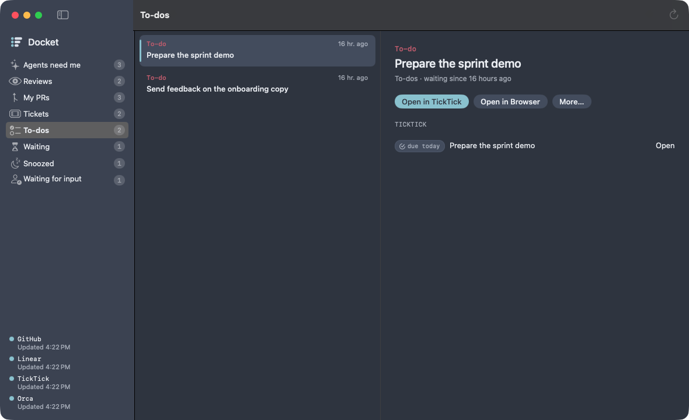
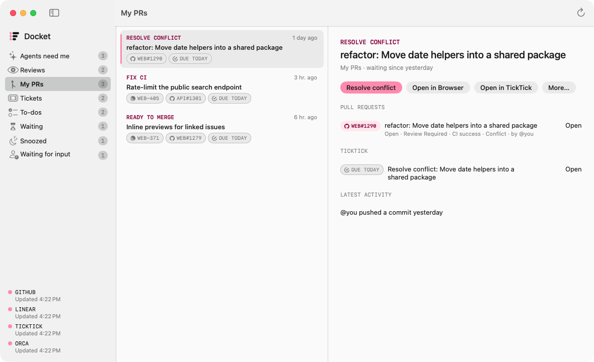

<p align="center">
  
</p>

<h1 align="center">Docket</h1>

<p align="center">
  <b>One ranked "what needs me next" list across GitHub, Linear, TickTick and your coding agents.</b><br>
  A native macOS app, built with SwiftUI.
</p>

<p align="center">
  
  
  
</p>

<p align="center">
  
</p>

---

Docket gathers everything that is waiting on you and puts it in one place, ranked:

- **🤖 Agents:** Orca workspaces whose agent is blocked, waiting for you, or done with an unread result.
- **👀 Reviews:** review requests and re-requests, read through your local `gh` login.
- **🔀 My PRs:** new feedback, failing CI, merge conflicts and PRs that are ready to merge.
- **🎫 Tickets:** your Linear tickets in Todo, In Progress and In Review.
- **✅ To-dos:** your TickTick tasks, synced both ways.

Press <kbd>↩</kbd> and Docket starts the work in [Orca](https://github.com/stablyai/orca). It checks out the branch, or a `review-<n>-<slug>` worktree for someone else's PR, and hands your agent a prompt. **Docket never writes to GitHub or Linear.** It only acts locally, in Orca or in TickTick.

## Screenshots

| My PRs | Reviews |
|---|---|
|  |  |
| **Tickets** | **To-dos from TickTick** |
|  |  |

Two themes, **Nord** and **n8n**, switchable from View → Theme:

| Nord | n8n |
|---|---|
|  |  |

<sub>The screenshots show made-up data from `Docket --demo`.</sub>

## Install

Docket is built from source. It takes about a minute.

### 1. Prerequisites

| What | Why | How |
|---|---|---|
| **macOS 15** or later | | |
| **Xcode** | Swift 6 toolchain | Install from the App Store, then run `sudo xcodebuild -license accept` and `xcodebuild -runFirstLaunch` |
| **GitHub CLI** | Reviews and PRs | `brew install gh`, then `gh auth login` |
| **Orca** *(recommended)* | Agent workspaces, Start work | Install [Orca](https://github.com/stablyai/orca) and add the repos you work in |
| Linear API key *(optional)* | Tickets | Linear → Settings → Security & access → Personal API keys |
| TickTick API token *(optional)* | To-dos and task sync | TickTick web → Settings → Account → API Token |

### 2. Build and install

```sh
git clone https://github.com/BerniWittmann/docket.git
cd docket
scripts/bundle.sh                  # release build, app icon, ad-hoc signature → Docket.app
mv Docket.app /Applications/
open /Applications/Docket.app
```

### 3. First launch

The first launch walks you through **GitHub → Linear → TickTick → Orca → notifications**. You can skip any step and connect it later in Settings (<kbd>⌘</kbd><kbd>,</kbd>).

Then open **Settings → Sources** and set the repos and orgs to watch, such as `my-org/*` or `owner/repo`.

> [!NOTE]
> **Keychain prompts after updating.** `bundle.sh` signs ad hoc, and macOS ties Keychain grants to the signature. After each rebuild, macOS asks again for access to the Linear key and TickTick token, so choose **Always Allow**. To avoid the prompts, create a code-signing certificate in Keychain Access (Certificate Assistant → Create a Certificate, type *Code Signing*) and build with:
> ```sh
> DOCKET_SIGN_IDENTITY="<certificate name>" scripts/bundle.sh
> ```

### Updating

```sh
cd docket && git pull && scripts/bundle.sh && rm -rf /Applications/Docket.app && mv Docket.app /Applications/
```

### Try it without accounts

```sh
open Docket.app --args --demo
```

Demo mode fills Docket with made-up items and doesn't touch GitHub, Linear, TickTick or Orca.

## Using it

| Key | Action |
|---|---|
| <kbd>↑</kbd> <kbd>↓</kbd> | Move through items |
| <kbd>⌘1</kbd> – <kbd>⌘8</kbd> | Agents need me, Reviews, My PRs, Tickets, To-dos, Waiting, Snoozed, Waiting for input |
| <kbd>↩</kbd> | Do the item's work: Review, Re-review, Address feedback, Fix CI, Resolve conflict, Start ticket, Continue ticket |
| <kbd>⌘O</kbd> | Open in the browser |
| <kbd>⌘C</kbd> | Copy the link |
| <kbd>S</kbd> / <kbd>D</kbd> / <kbd>M</kbd> | Snooze, Done (until new activity), Not mine (for good) |
| <kbd>⌘R</kbd> | Refresh now |

**Start work** reuses an existing worktree when there is one: the prompt goes to its idle agent session, a busy agent is only opened, and otherwise a new session starts. The button's tooltip says which. Items without work to start open in Orca, Linear or the browser.

**Worktrees.** Someone else's PR gets a review worktree named `review-<number>-<slug>`, such as `review-39409-handle-inbound-media`. Your own PRs are checked out on their head branch, and tickets on their Linear branch name.

**Re-reviews.** A PR you already reviewed returns to Reviews only when its author re-requests your review. Pushes and replies alone don't bring it back.

**Feedback.** An unresolved thread counts as feedback only when its last comment is newer than your last push or reply.

**Linking PRs to tickets.** Docket follows the branch convention: a branch named `abc-1234-some-slug`, or a title containing `ABC-1234`, belongs to ABC-1234. Your tickets claim those PRs even without a Linear attachment. Other people's PRs show their ticket (title, state, assignee) for context.

**Waiting for input.** Tickets in a waiting-for-input state go to their own group, unless their PR or agent needs you. You set the state's name in Settings → Sources; the default is "Waiting for input".

## TickTick sync

Connect a token and pick a list in Settings → Sources. Docket then keeps one TickTick task, tagged `#docket`, for each item that needs you:

| Item | Task |
|---|---|
| Needs you | Open, due today (all-day) |
| Snoozed | Open, due on the snooze day |
| Waiting, done (<kbd>D</kbd>), merged or closed | Completed |

- **Titles** start with the action, such as *"Address feedback: Set up Microsoft Teams again"*. The `feat(editor):` prefix and `(no-changelog)` are left out. Docket renames its own tasks when the action changes. Tasks you made keep your title.
- **Reopening.** When an item needs you again, its task is reopened.
- **Transitions only.** Docket writes only when an item changes state, so a task you complete or re-date in TickTick stays that way until then.
- **Outages.** Docket writes nothing while GitHub, Linear or TickTick reports an error, so an outage never completes your tasks.
- **Linking your own tasks.** Any open task that names a PR joins that item, and Docket adopts it instead of creating another. A PR can be named as `https://github.com/…/pull/123`, `repo#123` or `owner/repo#123`. A ticket can be named as `ABC-1234` or by its Linear URL.
- **To-dos.** `#docket` tasks that name nothing show up under To-dos. <kbd>D</kbd> completes them and <kbd>S</kbd> moves their due date.

GitHub, Linear and TickTick are polled every 2 minutes, and Orca every 10 seconds. Notifications fire only inside your work hours, once per event.

## Settings

| Tab | What's in it |
|---|---|
| **Sources** | Repos and orgs to watch, the repo for new ticket worktrees, the Linear key, the TickTick token and list, the Orca CLI path |
| **Work** | For each kind of work: the agent (default `claude`), the prompt (`{url}`, `{ticket}`, `{number}` and `{repo}` are filled in), and the automation. *Manual* waits for you; *Prepare* creates the worktree for new items inside work hours, without starting an agent |
| **Notifications** | One toggle per event |
| **Bots** | Review bots count as feedback. Noise bots and unknown bots are ignored |
| **Appearance** | Nord or n8n |
| **General** | Work hours (default Mon–Fri 8:00–18:00), launch at login |

State and settings live in `~/Library/Application Support/Docket/`.

## Development

```sh
export DEVELOPER_DIR=/Applications/Xcode.app/Contents/Developer
swift test          # rules, ranking, matching and sync, driven by recorded fixtures
scripts/bundle.sh   # builds Docket.app
```

The Command Line Tools alone build the app, but they ship no test framework, so the tests need Xcode.

The project has two parts:

- **`DocketCore`** holds the sources (GitHub, Linear, TickTick, Orca), the rules that turn them into ranked work items, and the sync.
- **`Docket`** is the SwiftUI app.

### Fixtures

`Tests/DocketCoreTests/Fixtures` holds real responses, scrubbed by `scripts/scrub-fixture.py`. Other people's logins become `user-N`, and titles and free text are replaced. To record new ones:

- `github-inbox*.json`: `DOCKET_LIVE=1 DOCKET_RECORD=<file> swift test --filter GitHubSourceTests/live`
- `linear-issues.json`: `Docket.app/Contents/MacOS/Docket --record-linear <file>`, which uses the key the app already has
- `orca-ps*.json`, `orca-repos.json`: `orca worktree ps --json`, `orca repo list --json`

Scenarios the recordings lack, such as a PR that is ready to merge or a merged PR on an open ticket, are derived in the tests from a recorded PR or ticket.
