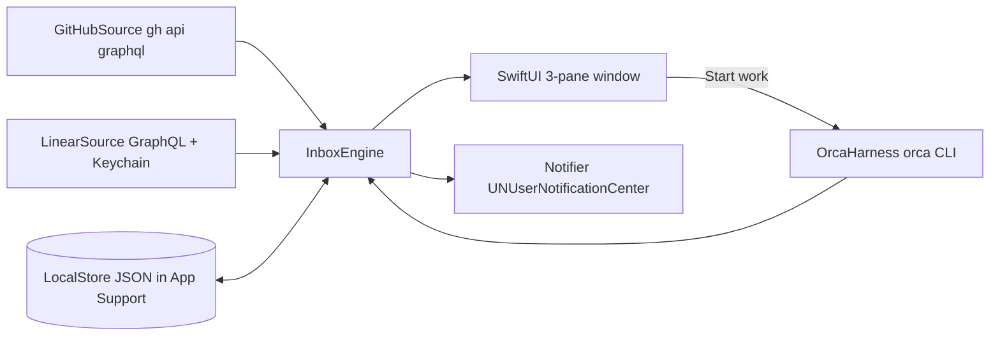

# Plan: Docket, a native macOS app

## Solution approach
Docket is a Swift package with two targets:
- **`DocketCore`**: models, rules, ranking, matching, persistence, and protocols for the sources and the harness. It does not import SwiftUI, so tests can cover it fully.
- **`Docket`** (executable): the SwiftUI app with its windows, settings, notifications, and adapters.

The sources are adapters behind small protocols:
- **GitHub:** the `gh` CLI.
- **Linear:** HTTPS GraphQL with a key stored in the Keychain.
- **Harness:** the Orca CLI.

The adapters feed one **`InboxEngine`**. It merges the raw facts into `WorkItem`s, applies the local state (snooze, done, not mine), assigns each item a group and a rank, and reports new events to the notifier.

`scripts/bundle.sh` wraps the release build in an ad-hoc signed `Docket.app`. The bundle has a real bundle ID (`dev.berni.docket`), so notifications and launch at login work.

**Prerequisite (done 2026-10-09):** the Xcode license is accepted. The Command Line Tools build SwiftUI but ship no XCTest or Swift Testing, as probed on 2026-10-09. After the license is accepted, tests run with `DEVELOPER_DIR=/Applications/Xcode.app/Contents/Developer swift test`. If that is not possible, the fallback is a `DocketChecks` executable target (`swift run DocketChecks`) that runs the same fixture cases with plain assertions.

## Ordered steps

1. **Scaffold** (fact 1).
   - Create `~/DEV/Docket/Package.swift` with macOS 15 and Swift 6, the targets `DocketCore`, `Docket` and `DocketCoreTests`, and `Resources/Info.plist`.
   - Write `scripts/bundle.sh` (`swift build -c release`, assemble `Docket.app`, `codesign -s -`), a `.gitignore` and a README.
   - `git init`.
   - **Verify:** `swift build` passes. `scripts/bundle.sh` produces `Docket.app`, and `open Docket.app` shows an empty window.

2. **Core model and rules** (facts 4, 10–17, 19–22, 24–26, 34, 39, 40).
   - `DocketCore/Model`:
     - `PullRequest`, `Ticket`, `Workspace`, `AgentState`.
     - `WorkItem`: a ticket and/or PRs and/or a workspace, with a kind, group, rank, headline, `lastActivityAt` and `activityFingerprint`.
     - `Group`: agents, reviews, myPRs, tickets, waiting, snoozed.
   - `Rules/GitHubRules.swift`: review, re-review, feedback (humans plus review bots, with noise bots ignored), "all change-requesters re-requested → waiting", CI, conflict, ready to merge, waiting for review.
   - `Rules/LinearRules.swift`: Start, Continue or Close. Todo ranks last.
   - `Rules/AgentRules.swift`: blocked, waiting or awaiting-decision → agents. Done and unread → "Check agent result". Unmatched workspaces with activity → agents, labelled with repo and branch.
   - `Merge.swift`:
     - A ticket owns its attached PRs (from Linear attachments).
     - A workspace attaches by linked PR, then by linked ticket, then by branch.
     - The item's group is the most urgent of its parts.
   - `Ranking.swift`: urgency first, then the oldest wait first.
   - **Verify:** fixture tests in `Tests/DocketCoreTests/Fixtures/*.json`. These are recorded from real `gh api graphql`, the Linear GraphQL API and `orca worktree ps --json`, then scrubbed. There is one test case per fact listed above.

3. **Local state and settings** (facts 8, 14, 30, 31, 33–35, 37, 38).
   - `LocalStore`: Codable JSON files under `~/Library/Application Support/Docket/`: `state.json` for snooze, done and not-mine marks keyed by item ID with the fingerprint at the time of marking, and `settings.json`.
   - New activity means the fingerprint changed. That wakes a snooze early and clears done.
   - `Settings` holds:
     - repos and orgs (default `n8n-io/*`), the review-bot and noise-bot lists;
     - work hours (Mon–Fri 8:00–18:00), the notification toggles and their defaults;
     - for each kind of work: agent, prompt template and automation (Manual or Prepare);
     - theme, Orca CLI path and launch at login.
   - `PromptTemplate` fills `{url}`, `{ticket}`, `{number}` and `{repo}`.
   - **Verify:** tests cover round-trip persistence, snooze expiry and early wake, done reappearing, not-mine staying hidden, template filling, and the work-hours window, including the Friday 18:00 and Monday 8:00 edges.

4. **GitHub source** (facts 7, 9, 43).
   - `GitHubSource` runs `gh api graphql -f query=…` through `Process`, with a timeout.
   - The query returns my authored PRs, review-requested PRs and involved PRs. For each PR it fetches `reviewDecision`, `mergeable`, `reviewRequests`, `latestReviews`, the timeline (comments, reviews, commits), `reviewThreads` and `statusCheckRollup`.
   - The search scope comes from the repos setting.
   - `gh auth status` provides the connection state. Any failure becomes a `SourceStatus.error(message)`.
   - Polling runs every 120 s, plus Refresh on demand.
   - **Verify:** run the query once and record a fixture. Manually, run `gh auth logout` in a test shell (or point the gh path at a missing binary) and check that only the GitHub source shows an error.

5. **Linear source** (facts 18, 19, 43).
   - `LinearSource` sends a POST to `https://api.linear.app/graphql` with the key read from the Keychain (`SecItem`, service `dev.berni.docket.linear`).
   - The query is `viewer { name assignedIssues(filter: state.type in [unstarted, started]) { identifier title url branchName updatedAt state { name type } attachments { url } } }`.
   - Polling runs every 120 s.
   - `validate(key)` returns the viewer's name, which the UI shows as "Connected as …".
   - **Verify:** a fixture test. Manually, an invalid key shows an error state while GitHub keeps working.

6. **Harness protocol and Orca adapter** (facts 23–29, 31).
   - `Harness` protocol: `listWorkspaces()`, `findWorkspace(for: WorkRef)`, `startWork(item, kind, prompt, agent)`, `prepare(item)`, `open(workspace)`.
   - `OrcaHarness` uses the CLI:
     - `ps --json` every 10 s;
     - reuse a worktree by `linkedPR`, then `linkedLinearIssue`, then branch;
     - create one with `worktree create --repo name:<repo> --pr/--linear-issue … --agent <agent> --prompt <prompt> --activate`:
       - my PR: on its head branch (fetched first);
       - someone else's PR: `review-<n>` from `refs/pull/<n>/head`;
       - a ticket: on its `branchName` from Linear.
     - Continue on an existing worktree: `terminal create --worktree id:… --focus`, which opens it with no new prompt.
   - Prepare creates the worktree without `--agent`, and only inside work hours.
   - The repo-to-path map comes from `orca repo list`.
   - **Verify:**
     - Fixture tests for the matching order and for the generated command lines, with a fake process runner.
     - Manually: Start work on a review creates `review-<n>` and starts `/pr-review <url>`. Doing it again reuses the worktree.

7. **App shell and three-pane UI** (facts 2, 3, 5, 6, 32, 43).
   - Build the UI with `NavigationSplitView`:
     - sidebar: the groups in a fixed order, each with a count, plus a source-status footer;
     - list: rows with headline, title, chips and age;
     - detail: ticket and PR chips with status, the latest activity (author and time), the agent status card (state, last message, since), and action buttons.
   - The commands menu has the shortcuts: ↑↓, ⌘1–⌘6, ↩, ⌘O, S, D, M, ⌘C and ⌘R.
   - The UI has no write actions to GitHub or Linear. Open in Linear and Open in browser only open URLs.
   - **Verify:** manually against real data. Each shortcut works. Every group matches what the GitHub and Linear web UIs show for the same PRs and tickets.

8. **Themes and logo** (facts 46–49).
   - `Theme` is a token struct with semantic roles: background (primary, secondary, tertiary), text (primary, secondary), accent, need (foreground, background), chip stroke, the three logo colours, the radius scale and the fonts.
   - **Nord:**
     - Polar Night `#2E3440`, `#3B4252`, `#434C5E`, `#4C566A`
     - Snow Storm `#D8DEE9`, `#ECEFF4`
     - Frost `#88C0D0` as the accent
     - Aurora red `#BF616A` for "need"
   - **n8n Light**, using only `n8ndesign.md` tokens:
     - backgrounds `#FAFAFA`, `#F1F1F1` and `#EAEAEA`; text `#191919` and black at 50%; accent `#FF91AC`;
     - need: `#87003C` on `#FFE8EC`;
     - spacing in multiples of 8, with 4 and 12 inside capsules; radius 8, 12 and full;
     - n8n Baumer Uniwidth or Mono, with mono capsule labels in ALL CAPS.
   - `DocketLogo` is a SwiftUI `Shape` or `Canvas` that redraws the existing SVG geometry from n8n Docket: a line from (7,8) to (7,24); pills at x=12, y=5/13/21, widths 17/13/9, height 6; dots of radius 3. It reads its colours from the theme.
   - The app icon is a static render of the logo in n8n colours.
   - The theme toggle lives in Settings and in the View menu, and persists across restarts.
   - **Verify:** manually switch themes and check that the colours and the logo change. Compare the n8n theme against the token table.

9. **Notifications** (facts 36–41).
   - `Notifier` wraps `UNUserNotificationCenter`. A delegate `willPresent` returns `.banner`, so banners also show while Docket is in front.
   - Categories with actions: `AGENT` with "Open in Orca", and `ITEM`.
   - Clicking selects the item in the main window.
   - The engine sends `InboxEvent`s (agentNeedsMe, agentResultUnread, newReview, humanFeedback, reviewBotFeedback, ciFailed, readyToMerge). The notifier filters them by toggle, work hours and local state. It sends each event at most once, using a de-duplication key of item ID and fingerprint persisted in `state.json`.
   - **Verify:** unit tests for the filter. Manually: make an agent wait for input, expect a banner within about 10 s, and check that clicking it selects the item.

10. **Onboarding and settings window** (facts 18, 42, 44).
    - First-run sheet with four skippable steps:
      - GitHub: run `gh auth status`, and show `gh auth login` with a copy button if needed.
      - Linear: a key field that validates and shows "Connected as …".
      - Orca: find `/Applications/Orca.app/Contents/Resources/bin/orca` or `which orca`, or accept a path.
      - Notifications: request permission.
    - Settings tabs: Sources, Work (one row per kind: agent, prompt, automation), Notifications, Bots, Appearance (theme), General (work hours, launch at login through `SMAppService.mainApp`).
    - **Verify:** manually: start once with the state folder removed and walk through each step. Skipping Linear leaves the app usable.

11. **Fixtures and wrap-up** (fact 45).
    - Record scrubbed fixtures for at least 6 real PRs (review, re-review, feedback by a human, feedback by a review bot only, re-requested reviewers, ready to merge), 3 tickets (Todo, In Progress with a PR, a merged PR on an open ticket) and 4 workspaces (blocked, done and unread, unmatched, idle).
    - Write the README with setup, the license prerequisite, bundling and settings.
    - **Verify:** `swift test` passes with the Xcode toolchain. `scripts/bundle.sh` and launching the app give a populated inbox from real data.

## Risks and open questions
- **Fonts (decided):** the n8n theme uses "n8n Baumer Uniwidth" and "n8n Baumer Mono" when they are installed, and the system font or system monospaced font otherwise. The owner approved this fallback.
- **Xcode license:** accepted on 2026-10-09. Swift Testing works with the Xcode toolchain.
- **Unmatched private PRs:** `gh` sees private repos, but GitHub search still needs `org:`-style scoping. If search misses private repos, query per repo.
- **Orca CLI drift:** Orca's CLI and JSON are not a stable API. The adapter decodes leniently and reports an error state when they change.
- **Ad-hoc signing:** notification permission and launch at login are tied to the bundle path and signature. Rebuilding into the same path keeps them, but moving the app may ask again.
- **Bot recognition:** review bots appear as `Bot` users or `[bot]` logins. The lists match case-insensitively on the login without the `[bot]` suffix.
